# BARB 12魚種レビュー一覧

AI生成: OpenAI image_gen.imagegen / BARB project。全12点を個別に目視確認済み。最終的な作品承認はユーザー・PMが行います。

以下は本番PNGそのものです。統一背景のコンタクトシートPNGは`report-fish-artwork.mjs`で生成し、Actionsの`browser-test-results`へ収録します。
[制作・出典・利用条件・品質](../FISH_ARTWORK.md) / [個別目視レビュー](fish-visual-review.md)。

|  |  |  |
| --- | --- | --- |
| 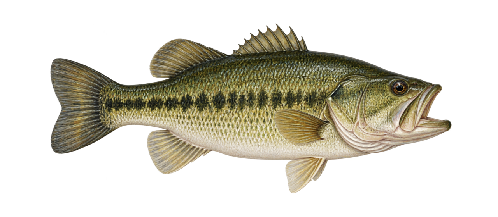 ブラックバス <code>black-bass</code> | 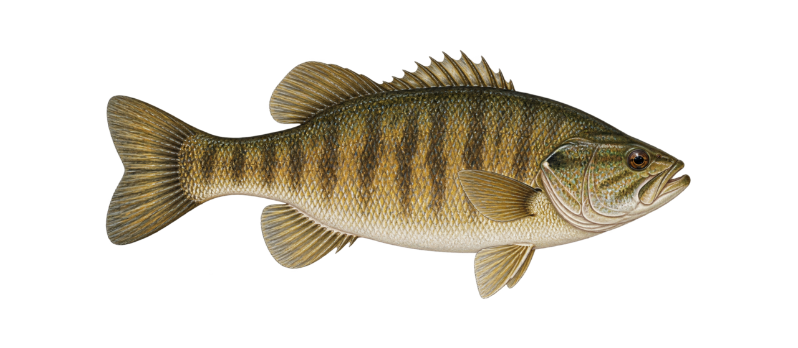 スモールマウスバス <code>smallmouth-bass</code> | 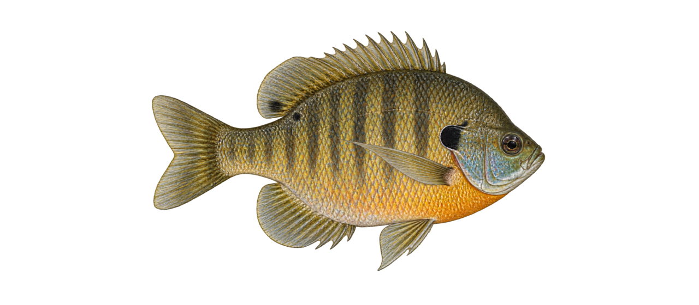 ブルーギル <code>bluegill</code> |
| 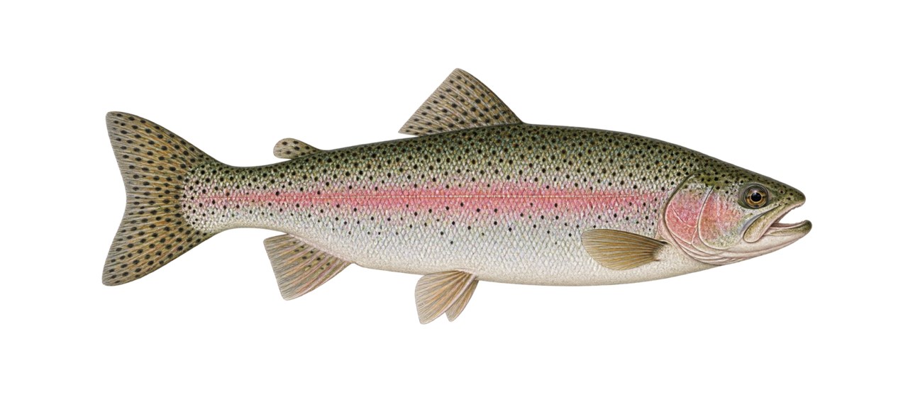 ニジマス <code>rainbow-trout</code> | 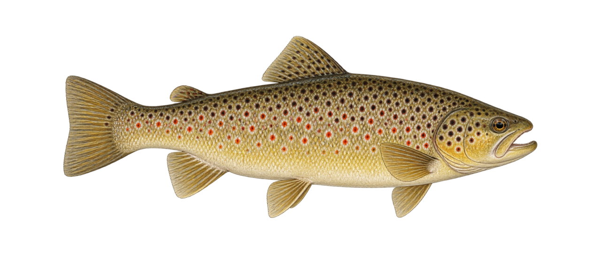 ブラウントラウト <code>brown-trout</code> | 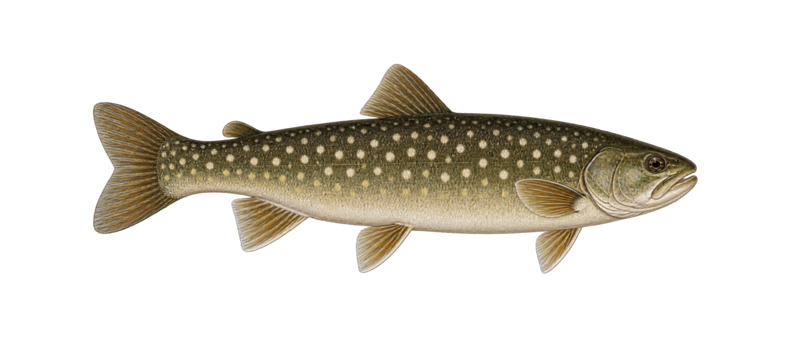 イワナ <code>iwana</code> |
| 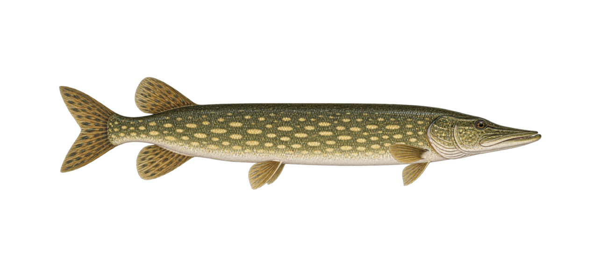 ノーザンパイク <code>northern-pike</code> | 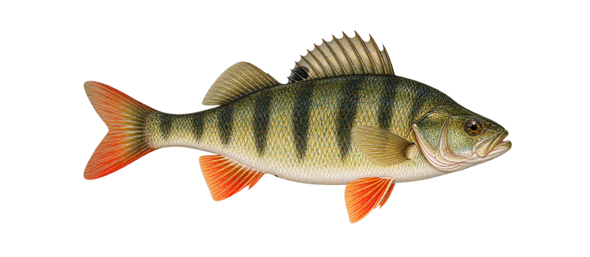 ヨーロピアンパーチ <code>european-perch</code> | 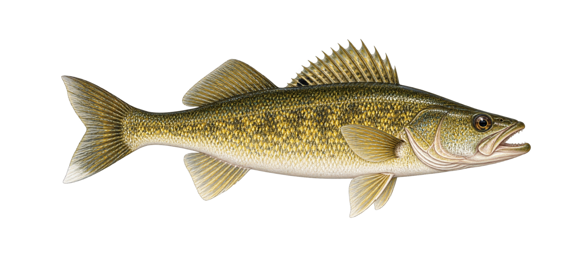 ウォールアイ <code>walleye</code> |
| 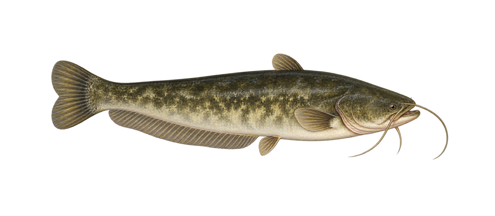 ナマズ <code>catfish</code> | 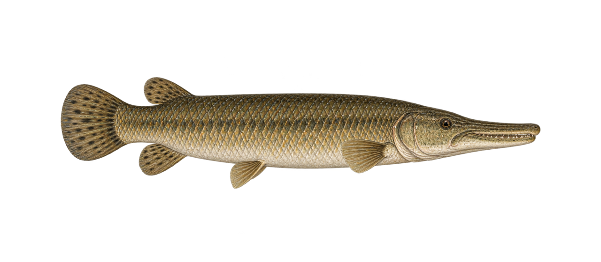 アリゲーターガー <code>alligator-gar</code> | 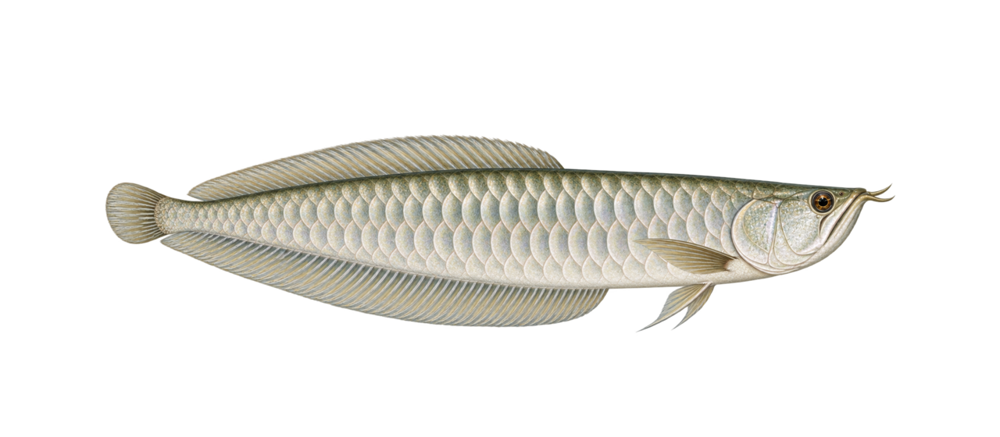 アロワナ <code>arowana</code> |
